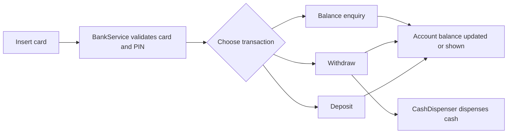

# ATM Simulation: Low-Level Design

An object-oriented design and Python implementation of an ATM system. It models the core pieces of a real ATM (cards, accounts, a bank backend, a cash dispenser, and transactions) as separate classes with clear responsibilities.

## Problem statement

Design an ATM that lets a customer:

- Insert a card and authenticate
- Check their account balance
- Withdraw cash
- Deposit money

The design should be modular, easy to extend with new transaction types, and keep ATM hardware concerns separate from banking logic.

## Class design

| Class (file) | Responsibility |
|--------------|----------------|
| `ATM` (`atm.py`) | The main controller: coordinates the card, the customer's actions, and the other components |
| `Card` (`card.py`) | Represents the customer's card and its details |
| `Account` (`account.py`) | Holds the customer's balance and supports debit and credit |
| `BankService` (`bank_service.py`) | The bank backend: validates cards and PINs and looks up accounts |
| `CashDispenser` (`cash_dispenser.py`) | Manages the ATM's cash and dispenses notes |
| `Transaction` (`transaction.py`) | Abstract base class defining the common interface for all transactions |
| `WithdrawTransaction` (`withdraw_transaction.py`) | Handles cash withdrawal |
| `DepositTransaction` (`deposit_transaction.py`) | Handles deposits |
| `BalanceEnquiry` (`balance_enquiry.py`) | Handles balance checks |

>  Responsibilities are inferred from file names. Edit each row to match what your classes actually do.

## Design highlights

- **Polymorphic transactions:** `Withdraw`, `Deposit`, and `BalanceEnquiry` all extend a common `Transaction` base class, so the ATM can run any of them through one interface. Adding a new transaction type (for example, a transfer) means adding one new class, without changing the ATM controller. ⚠️
- **Separation of concerns:** ATM hardware (`CashDispenser`) is kept apart from banking logic (`BankService`, `Account`), as in a real system.
- **Single responsibility:** each class owns one clear job, which makes the code easier to test and extend.

## Project structure

```
Design_atm_simulation_lld/
├── atm/
│   ├── __init__.py
│   ├── account.py
│   ├── atm.py
│   ├── balance_enquiry.py
│   ├── bank_service.py
│   ├── card.py
│   ├── cash_dispenser.py
│   ├── deposit_transaction.py
│   ├── transaction.py
│   └── withdraw_transaction.py
├── main.py              # Demo entry point
└── README.md
```

## How it works



>  Adjust the flow to match your `main.py` (for example, whether PIN validation happens and how the dispenser is checked).

## Getting started

### Prerequisites

- Python 3.8 or higher
- No external dependencies

### Run the simulation

```bash
git clone https://github.com/SyedaNaziaGit/Low-Level-System-Design-Case-Studies.git
cd Low-Level-System-Design-Case-Studies/Design_atm_simulation_lld
python main.py
```

## Concepts demonstrated

- Object-oriented design (encapsulation, abstraction, inheritance, polymorphism)
- SOLID principles, especially single responsibility and open/closed
- Modelling a real-world system as collaborating classes
- Clean module organisation in a Python package

---
