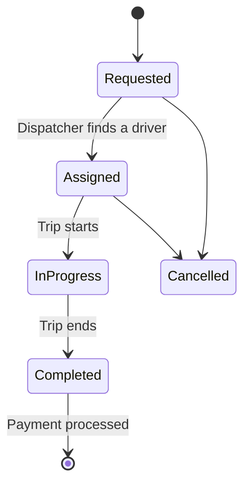

# Ride Sharing App (Uber): Low-Level Design

An object-oriented design and Python implementation of a ride-sharing system like Uber. It models passengers, drivers, vehicles, rides, and payments, and includes a dispatcher that matches ride requests with available drivers.

## Problem statement

Design a ride-sharing service that lets:

- **Passengers** request a ride from a pickup location to a destination
- **Drivers** be matched to nearby ride requests based on availability
- **Rides** move through a defined lifecycle, from requested to completed
- **Payments** be recorded and tracked once a ride is finished

The design should be modular, keep business logic separate from data models, and make it easy to add new vehicle types or matching rules.

## Class design

### Models

| Class (file) | Responsibility |
|--------------|----------------|
| `Passenger` (`passenger.py`) | A rider who requests rides |
| `Driver` (`driver.py`) | A driver with a vehicle, a location, and an availability status |
| `Vehicle` (`vehicle.py`) | The driver's vehicle, with a vehicle type |
| `Location` (`location.py`) | Coordinates used for pickup, drop-off, and driver positions |
| `Ride` (`ride.py`) | Links a passenger and driver and tracks the trip and its status |
| `Payment` (`payment.py`) | Records the payment for a ride and its status |

### Enums

| Enum (file) | Purpose |
|-------------|---------|
| `RideStatus` (`ride_status.py`) | Lifecycle states of a ride |
| `DriverStatus` (`driver_status.py`) | Whether a driver is available or busy |
| `PaymentStatus` (`payment_status.py`) | State of a ride's payment |
| `VehicleType` (`vehicle_type.py`) | Categories of vehicles |

### Services

| Service (file) | Responsibility |
|----------------|----------------|
| `Dispatcher` (`dispatcher.py`) | Finds and assigns a suitable available driver to a ride request |
| `RideService` (`ride_service.py`) | Orchestrates the ride flow: request, start, complete, and payment |

>  Responsibilities and the specific enum values are inferred from file names. Edit them to match your code.

## Design highlights

- **Layered structure:** `models` hold data, `enums` define fixed states, and `services` hold the business logic, so each layer has one clear job.
- **Enums over strings:** ride, driver, and payment states are explicit enums, which prevents invalid states and makes the lifecycle easy to follow.
- **Dedicated dispatcher:** driver matching lives in its own class, so you can change the matching rule (nearest driver, highest rating, vehicle type) without touching the ride flow. ⚠️
- **Single responsibility:** each model and service owns one concern, which makes the code easier to test and extend.

## Ride lifecycle



>  Replace these states with the actual values in your `RideStatus` enum.

## Project structure

```
Ride_sharing_app_Uber/
├── enums/
│   ├── driver_status.py
│   ├── payment_status.py
│   ├── ride_status.py
│   └── vehicle_type.py
├── models/
│   ├── __init__.py
│   ├── driver.py
│   ├── location.py
│   ├── passenger.py
│   ├── payment.py
│   ├── ride.py
│   └── vehicle.py
├── services/
│   ├── __init__.py
│   ├── dispatcher.py
│   └── ride_service.py
├── Overview             # Design notes
└── main.py              # Demo entry point
```

## Getting started

### Prerequisites

- Python 3.8 or higher
- No external dependencies

### Run the simulation

```bash
git clone https://github.com/SyedaNaziaGit/Low-Level-System-Design-Case-Studies.git
cd Low-Level-System-Design-Case-Studies/Ride_sharing_app_Uber
python main.py
```

## Concepts demonstrated

- Object-oriented design (encapsulation, abstraction, composition)
- SOLID principles, especially single responsibility and open/closed
- Modelling a real-world domain as collaborating classes and services
- State management with enums
- Clean package organisation in Python

## Possible extensions

- [ ] Fare calculation with a pricing strategy (distance, time, surge)
- [ ] Pluggable driver-matching strategies (Strategy pattern)
- [ ] Ride cancellation rules and fees
- [ ] Driver and passenger ratings
- [ ] Notifications with the Observer pattern
- [ ] Unit tests for the dispatcher and ride service

---
