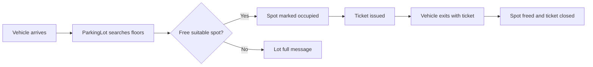

# Parking Lot System: Low-Level Design

An object-oriented design and Python implementation of a multi-floor parking lot. It models vehicles, parking floors and spots, and tickets, and handles parking and unparking vehicles of different types.

## Problem statement

Design a parking lot system that can:

- Hold multiple floors, each with multiple parking spots
- Park different types of vehicles (car, motorcycle, truck) in a suitable spot
- Issue a ticket when a vehicle enters
- Free the spot and close the ticket when the vehicle leaves
- Report when no suitable spot is available

The design should be modular and easy to extend with new vehicle types or spot-assignment rules.

## Class design

### Vehicles

| Class (file) | Responsibility |
|--------------|----------------|
| `Vehicle` (`vehicle.py`) | Base class holding what all vehicles share, such as the registration number and type |
| `Car` (`car.py`) | A car, extending `Vehicle` |
| `Motorcycle` (`motorcycle.py`) | A motorcycle, extending `Vehicle` |
| `Truck` (`truck.py`) | A truck, extending `Vehicle` |
| `VehicleType` (`vehicle_type.py`) | Enum of supported vehicle categories |

### Parking infrastructure

| Class (file) | Responsibility |
|--------------|----------------|
| `ParkingSpot` (`parking_spot.py`) | A single spot, with its type and whether it is free or occupied |
| `ParkingFloor` (`parking_floor.py`) | A floor that holds a collection of spots and finds a free one for a vehicle |
| `Ticket` (`ticket.py`) | Records a parked vehicle, its spot, and entry details, and is used at exit |

### Service

| Class (file) | Responsibility |
|--------------|----------------|
| `ParkingLot` (`services/parking_lot.py`) | The main entry point: manages the floors, parks vehicles, issues tickets, and handles exits |

>  Responsibilities are inferred from file names. Edit each row to match what your classes actually do.

## Design highlights

- **Inheritance for vehicles:** `Car`, `Motorcycle`, and `Truck` extend a common `Vehicle` base class, so the parking logic works with any vehicle through one interface. ⚠️
- **Composition for the lot:** a `ParkingLot` contains `ParkingFloor`s, which contain `ParkingSpot`s, mirroring the real-world structure.
- **Enum for types:** `VehicleType` replaces raw strings, which prevents invalid values and makes spot-matching clear.
- **Ticket as a record:** the `Ticket` ties a vehicle to a spot and entry time, so exit handling doesn't need to search for it. ⚠️
- **Models and services are separated:** data classes live in `models/`, and the business flow lives in `services/`.

## How it works



>  Adjust this to match `main.py`, for example whether exit calculates a fee.

## Project structure

```
parking_lot_system_lld/
├── models/
│   ├── car.py
│   ├── motorcycle.py
│   ├── parking_floor.py
│   ├── parking_spot.py
│   ├── ticket.py
│   ├── truck.py
│   ├── vehicle.py
│   └── vehicle_type.py
├── services/
│   └── parking_lot.py
├── main.py              # Demo entry point
├── requirements.txt
└── README.md
```

## Getting started

### Prerequisites

- Python 3.8 or higher

### Run the simulation

```bash
git clone https://github.com/SyedaNaziaGit/Low-Level-System-Design-Case-Studies.git
cd Low-Level-System-Design-Case-Studies/parking_lot_system_lld
pip install -r requirements.txt
python main.py
```

## Concepts demonstrated

- Object-oriented design (inheritance, encapsulation, composition)
- SOLID principles, especially single responsibility and open/closed
- Modelling a physical system (lot, floors, spots) as nested objects
- Using enums for fixed categories
- Clean package organisation in Python

## Possible extensions

- [ ] Fee calculation based on parking duration
- [ ] Pluggable spot-assignment strategies (nearest to entrance, lowest floor first)
- [ ] Separate entry and exit gates
- [ ] Spot types (compact, large, handicapped, EV charging)
- [ ] Thread-safe parking for concurrent entries
- [ ] Unit tests for park and unpark flows

---

## Author

**Syeda Nazia** · [GitHub](https://github.com/SyedaNaziaGit) · [LinkedIn](https://www.linkedin.com/in/syeda-nazia) · [Portfolio](https://syedanaziagit.github.io/nazia_portfolio_website/)
